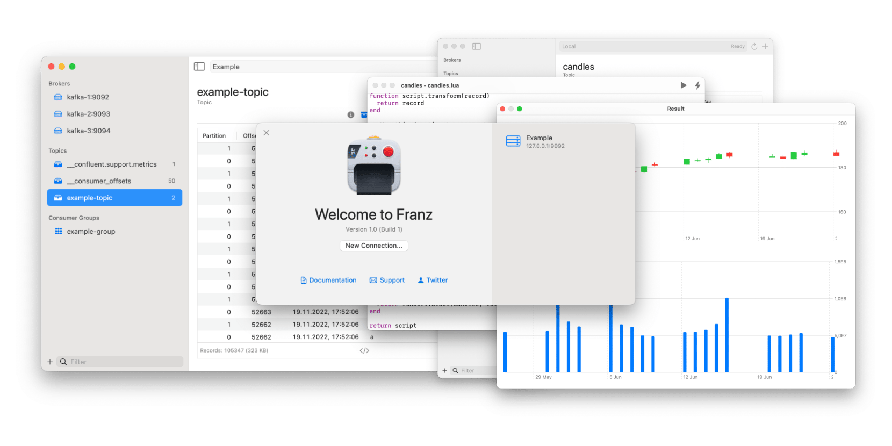

# Franz

  

Franz is a native desktop client for Apache Kafka on macOS, Linux and
Windows. It is Open Source, released under the 3-Clause BSD license.
Pre-built versions are available from [franz.defn.io].

[franz.defn.io]: https://franz.defn.io

## Build

### Requirements

* [Racket 9.3 CS](https://racket-lang.org/)
* macOS 26+
* Xcode 26+

### First-time Setup

1. Set up [Noise](https://github.com/Bogdanp/Noise).
1. `echo secret > core/secrets/license-secret.txt`
1. `raco pkg install --name franz core/`

### Building

    $ make

## License

Franz is licensed under the 3-Clause BSD license. See [LICENSE](LICENSE).
